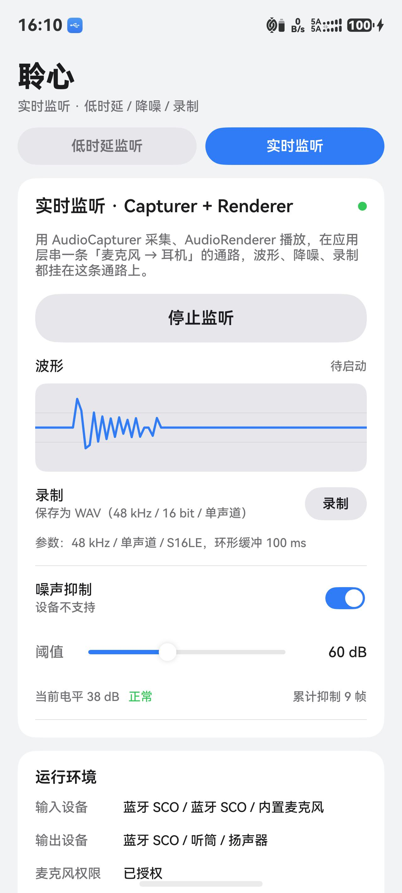
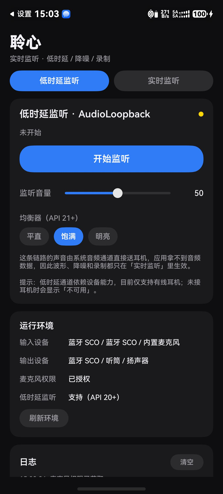
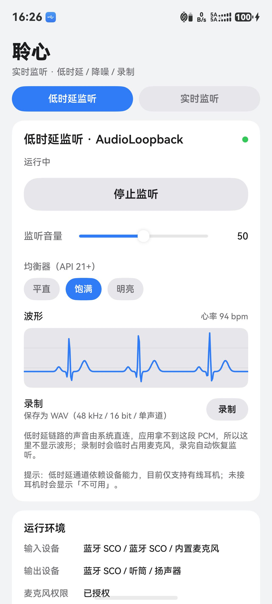

# 聆心 · Lingxin

> 基于 HarmonyOS Audio Kit 的实时监听（耳返）Demo：麦克风声音实时送到耳机，附带降噪、录音、波形可视化和蓝牙心率广播接收。
> 本项目由ai协助开发
<p align="center">
  
  
  
</p>
功能
| 功能 | 说明 |
|---|---|
| **低时延监听** | 基于 `AudioLoopback`（API 20+），系统直连，延迟最低，但应用拿不到 PCM |
| **实时监听** | `AudioCapturer` + `AudioRenderer` 串联，延迟略高但可介入波形、降噪、录制 |
| **噪声抑制** | `setNoiseReductionMode`（API 26+），支持 PURE_VOCALS / STANDARD / FIDELITY |
| **噪声门限** | 可调阈值（30–90 dB），低于阈值的声音不送到耳机，界面显示实时电平和累计抑制帧数 |
| **录音** | 48 kHz / 16 bit / 单声道 WAV，边录边写，每 2 秒回写一次文件头防止异常退出损坏 |
| **波形可视化** | 心电图纸风格的滚动波形，120 fps 渲染，单色线条，安静时自动压平 |
| **录音回放** | 列表内播放/停止/删除，回放时还原录制时的波形形状，支持在波形上拖动定位 |
| **心率广播** | BLE 扫描 + GATT 订阅心率测量特征 `0x2A37`，实时显示 bpm |
| **心电图** | 低时延监听页按心率节拍合成 PQRST 波形 |
| **主题** | 亮/暗双主题，跟随系统切换 |
环境要求
 DevEco Studio 26.0 及以上
- HarmonyOS SDK API 26（`compatibleSdkVersion` 设为 `6.0.0(20)`）
- 真机：音频相关能力模拟器不支持，必须真机调试
- 低时延监听依赖硬件能力，当前仅部分设备 + **有线耳机**可用
快速开始
```bash
git clone https://github.com/328960/AudioLoopbackDemo.git
cd AudioLoopbackDemo
```
用 DevEco Studio 打开工程根目录，等待 hvigor 同步完成。
配置签名
本仓库不包含任何证书和密码。首次构建请在 IDE 里配置一次：
`File` → `Project Structure` → `Signing Configs`
- Store File：你的 `.p12` 密钥库
- **Key Alias / 密码**
- **Profile File**：AGC 签发的 `.p7b`（调试用可勾选 `Automatically generate signature`）
- **Certpath File**：AGC 签发的 `.cer`
配置完成后 IDE 会把加密后的密码写入 `build-profile.json5`，**这份配置只留在你本机，不要提交**。
命令行构建
脚本会自动定位 DevEco Studio，顺序是：
1. `DEVECO_HOME` 环境变量
2. 从 `DEVECO_SDK_HOME` 反推父目录
3. 常见安装位置（`E:\DevEco Studio`、`D:\DevEco Studio`、`C:\Program Files\Huawei\DevEco Studio`）
装在其他盘的话，先设一次环境变量：
```powershell
setx DEVECO_HOME "D:\Your\DevEco Studio"
# 或者
setx DEVECO_SDK_HOME "D:\Your\DevEco Studio\sdk"
```
设置后**重新打开终端**，然后：
```powershell
# HAP（单模块安装包，可用于本地安装）
.\build.ps1
 或者 release 模式
.\build.ps1 -BuildMode release
```
脚本会依次尝试项目内 `node_modules/@ohos/hvigor`、`hvigorw.bat`，并把 JDK 加进 PATH（打包步骤需要 java）。
安装到设备：
```powershell
hdc install -r entry\build\default\outputs\default\entry-default-signed.hap
```
若需要应用市场分发的 `.app` 聚合包：
```powershell
node node_modules\@ohos\hvigor\bin\hvigor.js `
  -p product=default -p buildMode=release assembleApp --no-daemon
```
技术实现
两种监听链路
低时延：AudioLoopback
```ts
const loopback = audio.createAudioLoopback({
  rendererInfo: { usage: audio.StreamUsage.STREAM_USAGE_MUSIC, ... },
  mode: audio.AudioLoopbackMode.HARDWARE   // 目前仅支持 HARDWARE
});
await loopback.start();
```
声音由系统在硬件层直通，延迟最低，但**应用层拿不到这段 PCM**，所以这一页不显示音频波形，只显示心率心电图。
实时：Capturer + Renderer**
```ts
capturer.on('readData', (buffer) => {
  renderer.write(buffer);     // 原样转给耳机
  // 顺便算电平、波形、噪声门限
  return audio.AudioDataCallbackResult.VALID;
});
```
因为 PCM 经过应用层，所以波形、降噪、录制都挂在这条链路上。
心率广播
BLE 扫描 → 建立 GATT 连接 → 订阅心率测量特征：
```ts
ble.startBLEScan([{ serviceUuid: '0000180D-0000-1000-8000-00805F9B34FB' }]);
// 扫到设备后
const client = ble.createGattClientDevice(addr);
await client.connect();
const services = await client.getServices();
await client.setCharacteristicChangeNotification(hrCharacteristic, true);
```
心电图不是真实 ECG
BLE 心率服务只给 bpm 数值，没有原始 ECG 采样。低时延页的波形是按 bpm 节拍合成的 PQRST 复合波：

```ts
y += 0.12 * g(t, 0.18, 0.025);   // P 波
y -= 0.15 * g(t, 0.30, 0.010);   // Q
y += 1.00 * g(t, 0.33, 0.010);   // R 波（最高）
y -= 0.28 * g(t, 0.36, 0.010);   // S
y += 0.28 * g(t, 0.55, 0.040);   // T 波
```
周期 `60000 / bpm` 毫秒，心率变化时波形疏密会跟着变。
权限
| 权限 | 用途 |
|---|---|
| `ohos.permission.MICROPHONE` | 采集麦克风声音，实时送到耳机；录制 WAV |
| `ohos.permission.ACCESS_BLUETOOTH` | 扫描并连接蓝牙设备，读取心率广播 |
| `ohos.permission.APPROXIMATELY_LOCATION` | 蓝牙扫描的系统要求 |
本应用**不申请网络权限**，完全离线运行，不收集、不上传任何数据。
已知限制
- 低时延监听拿不到 PCM，所以这一页没有音频波形，只有由心率合成的心电图
- 低时延通道依赖设备能力，目前仅支持有线耳机，未接耳机时显示「不可用」
- 录音时会临时占用麦克风，低时延监听会暂停，录完自动恢复
- 噪声抑制依赖 `setNoiseReductionMode`（API 26+），部分设备返回不支持
- 心率广播需要设备（手表/心率带）主动开启广播
 目录结构

```
lingxin-audio/
├─ AppScope/app.json5                     # 应用配置（包名、版本、图标）
├─ entry/src/main/
│  ├─ ets/
│  │  ├─ pages/Index.ets                  # 全部 UI 与渲染循环
│  │  ├─ common/
│  │  │  ├─ AudioLoopbackController.ets   # AudioLoopback 封装
│  │  │  ├─ SoftwareEarMonitor.ets        # 采集/播放/降噪/录制/波形
│  │  │  ├─ HeartRateMonitor.ets          # BLE 心率订阅
│  │  │  └─ AudioEnv.ets                  # 设备与权限查询
│  │  └─ entryability/EntryAbility.ets    # 沉浸式窗口 + 主题
│  └─ resources/{base,dark}/element/color.json
├─ docs/screens/                          # 功能截图
└─ build-profile.json5                    # 构建配置（不含签名）
```

